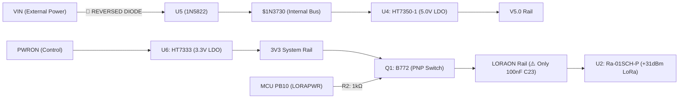

# Schematic Review Report: EasyEDA Active Design (RemoteNode)
**Source:** `EasyEDA Pro Live Bridge (EasyEDA_Active_Design)` | **BOM:** `Live Session BOM` | **Components:** 53 | **Nets:** 40

---

## Executive Summary & Action Items

| Severity | Issue Description | Impact | Recommended Action |
| :--- | :--- | :--- | :--- |
| 🔴 **CRITICAL** | **Reversed Input Schottky Diode U5 (1N5822)**: Cathode is wired to power input `VIN` and Anode to system rail `$1N3730`. | Complete power failure. Reverse-biased diode blocks all current from entering the system; regulators U4 and U6 remain unpowered. | Flip U5 orientation in schematic: connect **Anode to `VIN`** and **Cathode to `$1N3730`**. |
| 🟡 **WARNING** | **Missing Bulk Decoupling on LoRa Power Rail (`LORAON`)**: Ra-01SCH-P module draws 750mA–1A peak transmit current at +29/+31dBm, but `LORAON` only has high-frequency bypass $C23$ ($100\,\text{nF}$). | Voltage brownout / transient sag during RF packet transmission, causing packet corruption or MCU reset. | Place a **$10\,\mu\text{F}$ – $22\,\mu\text{F}$ low-ESR ceramic capacitor** in parallel with $C23$ directly at U2 Pin 3 (`LORAON`). |
| 🟡 **WARNING** | **Missing Noise Filter Capacitor on Reset Pin (`NRST` / U1.7)**: Only internal weak pull-up (~40kΩ) and TVS clamp present; no discrete RC filter. | Susceptibility to RF-induced rectification and false resets from the adjacent high-power LoRa antenna during transmission. | Add a **$100\,\text{nF}$ filter capacitor** between `NRST` and `GND` adjacent to STM32 Pin 7. |
| ℹ️ **NOTE** | **INA226 ADCs Configured for Voltage-Only Monitoring**: U7, U8, and U9 have `VIN+` and `VIN-` tied together directly to their respective rails (`VIN`, `ANALOGIN`, `V5.0`). | Shunt voltage is fixed at $0\,\text{mV}$; differential current measurement is disabled. | Informational: If current sensing is desired, insert an external current shunt resistor ($R_{\text{shunt}}$) between `VIN+` and `VIN-`. |

---

## 1. Power Architecture & Voltage Regulators

### Regulators Analysis
* **U6: HT7333 - 3.3V 250mA Low-Power LDO**
  * **Package:** `SOT-89-3` | **LCSC ID:** `C259241`
  * **Pin 1 (GND):** Tied to system ground `GND`.
  * **Pin 2 (VIN):** Connected to `PWRON`, decoupled with $C14$ ($10\,\mu\text{F}$).
  * **Pin 3 (VOUT):** Supplies `3V3`, decoupled with multiple high-frequency bypass caps ($C3, C4, C5, C18, C19, C20 = 100\,\text{nF}$, $C6, C22 = 10\,\text{nF}$) plus bulk reservoirs ($C24 = 100\,\mu\text{F}$, $C15 = 10\,\mu\text{F}$, $C7 = 1\,\mu\text{F}$). Stable operation guaranteed.
* **U4: HT7350-1 - 5.0V 250mA Low-Power LDO**
  * **Package:** `SOT-89-3` | **LCSC ID:** `C22466409`
  * **Pin 1 (GND):** Tied to system ground `GND`.
  * **Pin 2 (VIN):** Connected to `$1N3730`, decoupled with $C16$ ($10\,\mu\text{F}$).
  * **Pin 3 (VOUT):** Supplies `V5.0`, decoupled with $C17$ ($10\,\mu\text{F}$).

---

## 2. Power Switching & Transistors

| Designator | Transistor | Role | Control Pin | Base / Gate R | Pull Resistor | Status | Engineering Critique |
| :--- | :--- | :--- | :--- | :--- | :--- | :--- | :--- |
| **Q1** | B772 (PNP BJT) | High-side power switch for LoRa module (`LORAON`) | MCU `PB10` (`LORAPWR`) | $R2$ ($1\,\text{k}\Omega$) | $R21$ ($10\,\text{k}\Omega$ pull-up to `3V3`) | 🟢 PASS | Emitter properly on `3V3`, Collector on `LORAON`. $R21$ guarantees default-off state during microcontroller reset. Base current $I_B \approx 2.6\,\text{mA}$ ensures hard saturation for switching. |
| **Q2** | 2SD965T-R (NPN BJT) | Low-side ground switch for sensor port U14 (`SWITCHEDGND`) | MCU `PA15` (`P1NPN`) | $R4$ ($220\,\Omega$) | $R20$ pull-down to `GND` | 🟢 PASS | Emitter properly on `GND`, Collector on `SWITCHEDGND`. Pulldown keeps switch open during MCU tri-state/boot. |

---

## 3. Sensor Monitors & I2C Address Strapping

The design incorporates three **INA226** high-precision I2C monitors sharing the same I2C bus (`SDA` Pin 43, `SCL` Pin 42) with pull-up resistors $R5$ ($2.7\,\text{k}\Omega$) and $R6$ ($2.7\,\text{k}\Omega$).

| Designator | Name / Target | A1 Pin | A0 Pin | 7-bit Address | Monitored Line (`VBUS`) | Shunt Pins (`VIN+` / `VIN-`) | Status |
| :--- | :--- | :--- | :--- | :--- | :--- | :--- | :--- |
| **U7** | `SOLARADC` | `GND` | `3V3` (`VS`) | **`0x41`** | `VIN` | Tied to `VIN` | 🟢 Verified (Unique Address) |
| **U9** | `CAPADC` | `GND` | `SDA` | **`0x42`** | `V5.0` | Tied to `V5.0` | 🟢 Verified (Unique Address) |
| **U8** | `P1ADC` | `GND` | `SCL` | **`0x43`** | `ANALOGIN` | Tied to `ANALOGIN` | 🟢 Verified (Unique Address) |

* **Address Collision Audit:** 🟢 All three devices are properly strapped to distinct 7-bit addresses (`0x41`, `0x42`, `0x43`). No bus contention will occur.
* **Bus Termination:** 🟢 $2.7\,\text{k}\Omega$ pull-up resistors on both `SCL` and `SDA` provide sharp rise times for standard/fast mode I2C (100kHz–400kHz) given the total bus capacitance.

---

## 4. Microcontroller Hardware Silicon Verification (STM32U073C8T6)

* **Package:** `LFQFP-48` | **LCSC ID:** `C26733336`

### Silicon Alternate Function (AF) Cross-Reference
The netlist connections have been cross-referenced against the STMicroelectronics STM32U073 LQFP-48 silicon Alternate Function matrix:

| Bus | MCU Pin | Pin Name | Connected Net | Target Connection | Silicon AF Capability | Verified Status |
| :--- | :--- | :--- | :--- | :--- | :--- | :--- |
| **I2C1** | Pin 42 | `PB6` | `SCL` | U7.5, U8.2/5, U9.5 | `I2C1_SCL` (AF1) | 🟢 **PASS** (Direct HW Support) |
| **I2C1** | Pin 43 | `PB7` | `SDA` | U7.4, U8.4, U9.2/4 | `I2C1_SDA` (AF1) | 🟢 **PASS** (Direct HW Support) |
| **SPI1** | Pin 14 | `PA4` | `LORANSS` | U2.15 (`NSS`) | `SPI1_NSS` (AF0) | 🟢 **PASS** (Direct HW Support) |
| **SPI1** | Pin 15 | `PA5` | `LORASCK` | U2.12 (`SCK`) | `SPI1_SCK` (AF0) | 🟢 **PASS** (Direct HW Support) |
| **SPI1** | Pin 16 | `PA6` | `LORAMISO` | U2.13 (`MISO`) | `SPI1_MISO` (AF0) | 🟢 **PASS** (Direct HW Support) |
| **SPI1** | Pin 17 | `PA7` | `LORAMOSI` | U2.14 (`MOSI`) | `SPI1_MOSI` (AF0) | 🟢 **PASS** (Direct HW Support) |
| **USART2** | Pin 12 | `PA2` | `P4TX` | U17.3 (External UART) | `USART2_TX` (AF7) | 🟢 **PASS** (Direct HW Support) |
| **USART2** | Pin 13 | `PA3` | `P4RX` | U17.2 (External UART) | `USART2_RX` (AF7) | 🟢 **PASS** (Direct HW Support) |
| **USART1** | Pin 30 | `PA9` | `PTX` | H3.5 (Debug Header) | `USART1_TX` (AF7) | 🟢 **PASS** (Direct HW Support) |
| **USART1** | Pin 31 | `PA10` | `PRX` | H3.6 (Debug Header) | `USART1_RX` (AF7) | 🟢 **PASS** (Direct HW Support) |
| **SWD** | Pin 34 | `PA13` | `PSWDIO` | H3.2 (Debug Header) | `SWDIO` (AF0) | 🟢 **PASS** (Direct HW Support) |
| **SWD** | Pin 37 | `PA14` | `PSWCLK` | H3.3 (Debug Header) | `SWCLK` (AF0) | 🟢 **PASS** (Direct HW Support) |

### Clocking, Boot, and Reset Integrity
* **HSE Oscillator:** 🟢 $8\,\text{MHz}$ Crystal $X1$ on Pins 5/6 (`PF0`/`PF1` or `OSC_IN`/`OSC_OUT`) with matched $22\,\text{pF}$ load capacitors $C12$ and $C13$.
* **LSE RTC Oscillator:** 🟢 $32.768\,\text{kHz}$ Watch Crystal $X2$ on Pins 3/4 (`PC14`/`PC15` or `OSC32_IN`/`OSC32_OUT`) with matched $10\,\text{pF}$ load capacitors $C10$ and $C11$.
* **Boot0 Selection:** 🟢 Pin 44 (`BOOT0`) tied to `GND` via $R1$ ($10\,\text{k}\Omega$) ensuring boot from Main Flash memory.
* **NRST Integrity:** 🟡 Pin 7 (`NRST`) relies on the internal weak pull-up. An external $100\,\text{nF}$ filter cap to GND is strongly advised to prevent RF reset glitches.

---

## 5. Wireless Transceiver Module (U2: Ra-01SCH-P)

* **RF Core:** Semtech LLCC68 with integrated Power Amplifier / LNA
* **Peak Output Power:** $+29\,\text{dBm}$ (3.3V) to $+31\,\text{dBm}$ (5V)
* **Operating Current:** Up to $750\,\text{mA} - 1000\,\text{mA}$ during high-power transmit bursts

| Pin | Name | Connected Net | Function / Status |
| :--- | :--- | :--- | :--- |
| **2, 9, 16, 17** | `GND` | `GND` | Multiple ground return pins tied to common ground plane. |
| **3** | `VCC` | `LORAON` | Powered via Q1 high-side switch. **Needs bulk reservoir capacitor ($10\,\mu\text{F} - 22\,\mu\text{F}$) added.** |
| **4** | `RESET` | `LORARST` | Active-low reset connected to MCU. |
| **6** | `DIO1` | `LORADIO` | Digital interrupt output connected to MCU. |
| **10** | `BUSY` | `LORABUSY` | Transceiver busy status flag connected to MCU. |
| **12** | `SCK` | `LORASCK` | SPI Clock from MCU Pin 15 (`PA5`). |
| **13** | `MISO` | `LORAMISO` | SPI MISO to MCU Pin 16 (`PA6`). |
| **14** | `MOSI` | `LORAMOSI` | SPI MOSI from MCU Pin 17 (`PA7`). |
| **15** | `NSS` | `LORANSS` | SPI Chip Select from MCU Pin 14 (`PA4`). |

---

## 6. Protection & Interface Clamping (D1: SP720ABTG)

The SP720ABTG multi-channel TVS diode array is connected with its negative rail on `GND` and positive clamp on `3V3`:
* Protects external signal and debug lines: `ANALOGIN`, `NRST`, `P2BS`, `P3BS`, `P4RX`, `P4TX`, `PRX`, `PSWCLK`, `PSWDIO`, `PTX`.
* Clamping diodes suppress electrostatic discharge (ESD) and voltage spikes on exposed I/O connectors, preventing damage to the STM32 GPIO pins.
