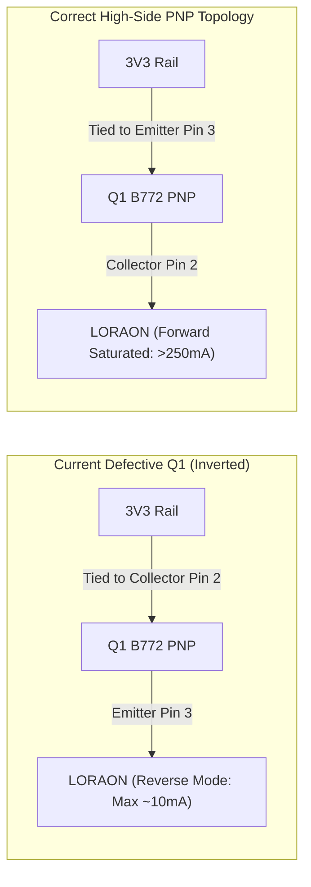

# Schematic Review Report: EasyEDA_Active_Design
**Source:** `EasyEDA Pro Live Bridge (EasyEDA_Active_Design)` | **BOM:** `Live Session BOM` | **Components:** 54 | **Nets:** 41

---

## Executive Summary & Engineering Verdict

A new schematic audit was executed against the active EasyEDA Pro session. The design incorporates an **STM32U073C8T6** MCU, an **Ai-Thinker Ra-01SCH-P** LoRa transceiver, dual LDO power architecture ($5.0\,\text{V}$ and $3.3\,\text{V}$), three **INA226** precision I2C ADCs, and a 14-channel **SP720ABTG** TVS protection array.

> [!CAUTION]
> ### 🔴 CRITICAL HARDWARE DEFECTS DETECTED
> The board **will not power on** and the LoRa subsystem **cannot transmit** in the current schematic state:
> 1. **Backwards Input Diode (`U5` - 1N5822):** Cathode is connected to `VIN` and Anode to internal rail `$1N3730`. All input power from connector `U3` is blocked by reverse bias!
> 2. **Inverted PNP Transistor Switch (`Q1` - B772):** In SOT-89, Pin 2 is Collector and Pin 3 is Emitter. Collector is wired to `3V3` and Emitter is wired to `LORAON`. In a high-side PNP switch, the **Emitter must be connected to 3.3V and the Collector to the load**. In inverted mode, $\beta_R$ drops to $\approx 2 - 5$, severely current-starving the LoRa module during RF transmissions!

* **Overall Status:** **🔴 FAILED (Design changes required before PCB layout)**
* 🔴 **CRITICAL ISSUES (2):** Backwards Schottky diode `U5`, Inverted PNP high-side switch `Q1`.
* 🟡 **WARNINGS & DESIGN RECOMMENDATIONS (3):**
  1. **LoRa Decoupling Bulk Capacitance:** Only a single $100\,\text{nF}$ capacitor (`C23`) decouples `LORAON`. Recommend adding $10\,\mu\text{F}$ to $22\,\mu\text{F}$ ceramic.
  2. **Reed Switch Debounce Time Constant (`C21`):** $10\,\mu\text{F}$ capacitor with internal MCU pull-up yields $\tau_{rise} \approx 400\,\text{ms}$, leading to missed pulses. Recommend $100\,\text{nF}$ + external $10\,\text{k}\Omega$ pull-up.
  3. **Reset Pin Noise Margin (`U1` Pin 7):** Missing external $10\,\text{k}\Omega$ pull-up resistor on `NRST`.
* 🟢 **INFO & PASS (40 checks passed):** Valid STM32 alternate functions, zero I2C address collisions, correct crystal oscillator loading, and TVS rail clamping.

---

## 1. Diodes & Protection Arrays

| Designator | Part Number | Package | Type | Anode (Pin & Net) | Cathode (Pin & Net) | Series Resistor | Status | Engineering Critique |
| :--- | :--- | :--- | :--- | :--- | :--- | :--- | :--- | :--- |
| **U5** | 1N5822 | DO-214AC | DIODE | Pin 2 (`$1N3730`) | Pin 1 (`VIN`) | None | 🔴 **CRITICAL FAIL** | **Backwards Diode:** Cathode is tied to input power `VIN` (from connector `U3`) and Anode to system rail `$1N3730` (feeding LDO `U4`). Under positive input voltage, `U5` is reverse-biased; **no current can enter the board**. <br>**Fix:** Swap pins so Anode is on `VIN` and Cathode is on `$1N3730`. |
| **D1** | SP720ABTG | SOIC-16 | TVS_ARRAY | Pin 8 (`GND`) | Pin 16 (`3V3`) | N/A | 🟢 PASS | Multi-channel SCR/diode TVS array protecting 10 signal lines (`ANALOGIN`, `NRST`, `P2BS`, `P3BS`, `P4RX`, `P4TX`, `PRX`, `PSWCLK`, `PSWDIO`, `PTX`). Ground return and V+ clamps properly tied. |

---

## 2. Transistors & Power Switching Circuits

| Designator | Part Number | Package | Type | Base / Gate | Collector / Drain | Emitter / Source | Series R | Bias / Pull R | Status | Engineering Critique |
| :--- | :--- | :--- | :--- | :--- | :--- | :--- | :--- | :--- | :--- | :--- |
| **Q1** | B772 | SOT-89-3 | BJT_PNP | Pin 1 (`$1N3369`) | Pin 2 (`3V3`) | Pin 3 (`LORAON`) | `R2` ($1\,\text{k}\Omega$) | `R21` ($100\,\text{k}\Omega$) | 🔴 **CRITICAL FAIL** | **Inverted PNP Switch:** In SOT-89, Pin 2 is Collector (center tab) and Pin 3 is Emitter. In a PNP high-side switch, the **Emitter must be connected to the positive supply rail (`3V3`) and Collector to the load (`LORAON`)**. When inverted, the transistor operates in reverse active mode with $\beta_R \approx 2 - 5$. At $I_B \approx 2.5\,\text{mA}$, maximum available output current is only $5 - 12\,\text{mA}$, causing catastrophic voltage drop during LoRa transmission ($120\,\text{mA}$). |
| **Q2** | 2SD965T-R | SOT-89-3 | BJT_NPN | Pin 1 (`$1N6158`) | Pin 2 (`SWITCHEDGND`) | Pin 3 (`GND`) | `R4` ($220\,\Omega$) | `R20` ($100\,\text{k}\Omega$) | 🟢 PASS | Correct low-side NPN switch. Emitter is on system `GND`, Collector gates sensor ground return `SWITCHEDGND`. $V_{CE(sat)} < 0.08\,\text{V}$. |



---

## 3. Power Architecture & Voltage Regulators

```mermaid
flowchart TD
    VIN["U3: VIN (Solar / Battery)"] -.->|Cathode Pin 1 (BLOCKED)| U5["U5: 1N5822 (Backwards)"]
    U5 -.-> N3730["$1N3730 (No Power)"]
    N3730 --> U4["U4: HT7350-1 (5.0V LDO)"]
    U4 --> V50["V5.0 Rail"]
    V50 --> H6["H6: Jumper Switch"] --> H5["H5: SuperCap Array"]
    V50 -.-> U9["U9: CAPADC (INA226 @ 0x42)"]
    V50 --> H1["H1: Power Select Header"]
    H1 --> PWRON["PWRON Rail"]
    PWRON --> U6["U6: HT7333 (3.3V LDO)"]
    U6 --> V33["3V3 System Rail"]
    V33 --> U1["U1: STM32U073C8T6 MCU"]
```

### U4: HT7350-1 - 5.0V Low Dropout Regulator
* **Package:** `SOT-89-3` | **LCSC ID:** `C22466409` | **Datasheet:** [HT7350-1](https://item.szlcsc.com/datasheet/HT7350-1/24165596.html)
* **Input Voltage:** `$1N3730` (blocked by `U5` until corrected).
* **Decoupling:** `C16` ($10\,\mu\text{F}$) on input, `C17` ($10\,\mu\text{F}$) on output. 🟢 PASS.

| Pin | Name | Connected Net | Electrical Role | Capacitance to GND |
| :--- | :--- | :--- | :--- | :--- |
| 1 | GND | `GND` | Ground Reference | Common ground plane return |
| 2 | VIN | `$1N3730` | Raw Input Power | `C16` ($10\,\mu\text{F}$) |
| 3 | VOUT | `V5.0` | 5.0V Output Rail | `C17` ($10\,\mu\text{F}$) |

### U6: HT7333 - 3.3V Low Dropout Regulator
* **Package:** `SOT-89-3` | **LCSC ID:** `C259241` | **Datasheet:** [HT7333](https://item.szlcsc.com/datasheet/HT7333/24165595.html)
* **Input Voltage:** `PWRON` (selected via 3-pin header `H1`).
* **Decoupling:** `C14` ($10\,\mu\text{F}$) on input; bulk `C24` ($100\,\mu\text{F}$) + `C15` ($10\,\mu\text{F}$) + $6\times 100\,\text{nF}$ + $2\times 10\,\text{nF}$ + $1\,\mu\text{F}$ on output. 🟢 PASS.

| Pin | Name | Connected Net | Electrical Role | Capacitance to GND |
| :--- | :--- | :--- | :--- | :--- |
| 1 | GND | `GND` | Ground Reference | Common ground plane return |
| 2 | VIN | `PWRON` | Input from `H1.2` | `C14` ($10\,\mu\text{F}$) |
| 3 | VOUT | `3V3` | Main 3.3V System Rail | `C24` ($100\,\mu\text{F}$) + `C15` ($10\,\mu\text{F}$) + bypass matrix |

---

## 4. Current & Voltage Monitoring Array (I2C Bus)

All three INA226 power monitors share the I2C1 bus (`SCL` on PB6, `SDA` on PB7) pulled up with `R6` ($2.7\,\text{k}\Omega$) and `R5` ($2.7\,\text{k}\Omega$).

| Designator | Device | Subsystem Monitored | A1 Pin | A0 Pin | 7-bit Address | Bus Status | Monitored Voltage Range |
| :--- | :--- | :--- | :--- | :--- | :--- | :--- | :--- |
| **U7** | INA226 | `SOLARADC` (Solar / Battery Input) | `GND` | `3V3` (`VS`) | **0x41** | 🟢 PASS | `VBUS` tied to `VIN` ($0\,\text{V}$ to $36\,\text{V}$) |
| **U9** | INA226 | `CAPADC` (SuperCap / 5V Buffer) | `GND` | `SDA` | **0x42** | 🟢 PASS | `VBUS` tied to `V5.0` ($0\,\text{V}$ to $5.5\,\text{V}$) |
| **U8** | INA226 | `P1ADC` (External Sensor Input) | `GND` | `SCL` | **0x43** | 🟢 PASS | `VBUS` tied to `ANALOGIN` |

* 🟢 **Address Verification:** Addresses `0x41`, `0x42`, and `0x43` are unique with zero conflict.

---

## 5. RF & Wireless Transceiver (U2: Ra-01SCH-P)

* **Module:** Ai-Thinker `Ra-01SCH-P` (Semtech SX1262 LoRa Core) | **Package:** SMD-16 | **LCSC ID:** `C41368034`

| Pin | Name | Connected Net | Electrical Role | Target Connection | Status |
| :--- | :--- | :--- | :--- | :--- | :--- |
| 2, 9, 16, 17 | GND | `GND` | Ground Reference | System GND plane | 🟢 PASS |
| 3 | VCC | `LORAON` | Switched 3.3V Power | Emitter of `Q1.3` (Inverted) | 🔴 **CRITICAL FAIL (via Q1)** |
| 4 | RESET | `LORARST` | Hardware Reset | MCU Pin 18 (GPIO Out) | 🟢 PASS |
| 6 | DIO1 | `LORADIO` | Multi-purpose Interrupt | MCU Pin 19 (EXTI In) | 🟢 PASS |
| 10 | BUSY | `LORABUSY` | Transceiver Busy Status | MCU Pin 20 (GPIO In) | 🟢 PASS |
| 12 | SCK | `LORASCK` | SPI Serial Clock | MCU Pin 15 (SPI1_SCK) | 🟢 PASS |
| 13 | MISO | `LORAMISO` | SPI Master In / Slave Out | MCU Pin 16 (SPI1_MISO) | 🟢 PASS |
| 14 | MOSI | `LORAMOSI` | SPI Master Out / Slave In | MCU Pin 17 (SPI1_MOSI) | 🟢 PASS |
| 15 | NSS | `LORANSS` | SPI Slave Select | MCU Pin 14 (SPI1_NSS) | 🟢 PASS |

---

## 6. Microcontroller & Bus Pin Mapping (U1: STM32U073C8T6)

* **Package:** `LFQFP-48` ($7\times7\,\text{mm}$, 0.5mm pitch) | **LCSC ID:** `C26733336`

### Hardware Alternate Function (AF) Validation Matrix

| MCU Pin | Silicon Pin Name | Net | Hardware AF Function | Target Component | ESD Protection | Status |
| :--- | :--- | :--- | :--- | :--- | :--- | :--- |
| **Pin 12** | `PA2` | `P4TX` | `USART2_TX` [AF1] | `U17` (UART Connector).3 | `D1.3` (TVS) | 🟢 PASS |
| **Pin 13** | `PA3` | `P4RX` | `USART2_RX` [AF1] | `U17` (UART Connector).1 | `D1.4` (TVS) | 🟢 PASS |
| **Pin 14** | `PA4` | `LORANSS` | `SPI1_NSS` [AF0] / GPIO | `U2` (Ra-01SCH-P).15 | None | 🟢 PASS |
| **Pin 15** | `PA5` | `LORASCK` | `SPI1_SCK` [AF0] | `U2` (Ra-01SCH-P).12 | None | 🟢 PASS |
| **Pin 16** | `PA6` | `LORAMISO` | `SPI1_MISO` [AF0] | `U2` (Ra-01SCH-P).13 | None | 🟢 PASS |
| **Pin 17** | `PA7` | `LORAMOSI` | `SPI1_MOSI` [AF0] | `U2` (Ra-01SCH-P).14 | None | 🟢 PASS |
| **Pin 30** | `PA9` | `PTX` | `USART1_TX` [AF1] | `H3` (ProgDebug).5 | `D1.10` (TVS) | 🟢 PASS |
| **Pin 31** | `PA10` | `PRX` | `USART1_RX` [AF1] | `H3` (ProgDebug).6 | `D1.11` (TVS) | 🟢 PASS |
| **Pin 34** | `PA13` | `PSWDIO` | `SWDIO` [AF0] | `H3` (ProgDebug).2 | `D1.6` (TVS) | 🟢 PASS |
| **Pin 37** | `PA14` | `PSWCLK` | `SWCLK` [AF0] | `H3` (ProgDebug).3 | `D1.7` (TVS) | 🟢 PASS |
| **Pin 42** | `PB6` | `SCL` | `I2C1_SCL` [AF1] | `U7.5`, `U8.5`, `U9.5` | None (On-board) | 🟢 PASS |
| **Pin 43** | `PB7` | `SDA` | `I2C1_SDA` [AF1] | `U7.4`, `U8.4`, `U9.4` | None (On-board) | 🟢 PASS |
| **Pin 44** | `BOOT0` | `$1N612` | Boot Configuration | Tied to GND via `R1` ($10\,\text{k}\Omega$) | None | 🟢 PASS |
| **Pin 7** | `NRST` | `NRST` | Asynchronous Reset | Filter `C1` ($100\,\text{nF}$), `H3.4` | `D1.9` (TVS) | 🟡 **WARN (No ext pull-up)** |

---

## 7. Actionable Redlines for Immediate Fix in EasyEDA

1. **Fix Backwards Diode `U5` (1N5822):**
   * Rotate or flip `U5` in EasyEDA so that Pin 1 (Cathode) is connected to `$1N3730` and Pin 2 (Anode) is connected to `VIN`.
2. **Fix Inverted Transistor `Q1` (B772):**
   * Connect Pin 3 (Emitter) to `3V3` and Pin 2 (Collector / Tab) to `LORAON`.
   * Ensure base pull-up resistor `R21` ($100\,\text{k}\Omega$) connects between Base (Pin 1) and Emitter (Pin 3 on `3V3`).
3. **Add Bulk Decoupling on `LORAON`:**
   * Place a $10\,\mu\text{F}$ 1206 ceramic capacitor between `LORAON` and `GND` right at `U2` Pin 3.
4. **Correct Reed Switch Debounce Capacitor `C21`:**
   * Change `C21` from $10\,\mu\text{F}$ to $100\,\text{nF}$, and add an external $10\,\text{k}\Omega$ pull-up resistor from `MAGBS` to `3V3`.
5. **Add Reset Pull-Up:**
   * Place a $10\,\text{k}\Omega$ resistor from `NRST` to `3V3` adjacent to `U1` Pin 7.
